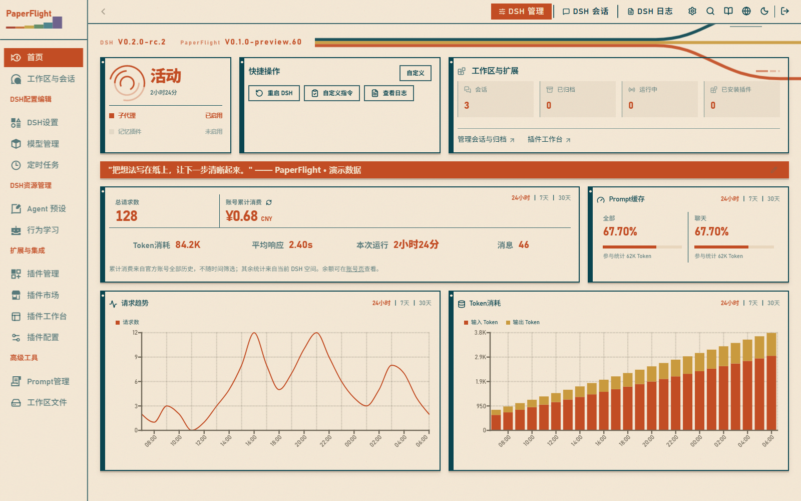
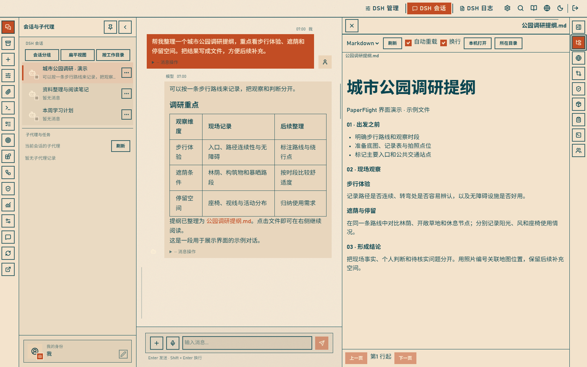
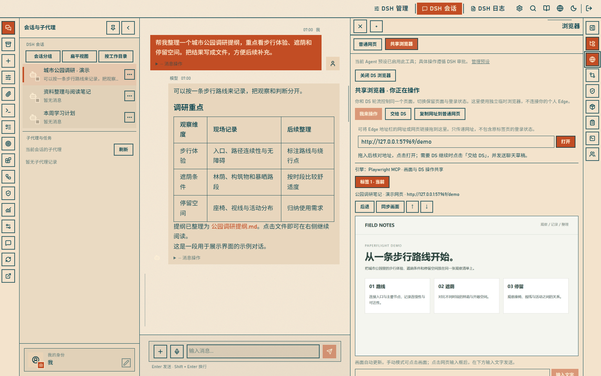

# 纸航 PaperFlight for DSH

**给 DeepSeek Harness 一张纸面质感的工作台。**

未来复古的 Web 界面，把会话、文件预览、审批和可选的浏览器 / CMD 工具放在同一个工作空间里。

[下载 preview.60](https://github.com/bagpipe1289/dsh-paperflight/releases/tag/v0.1.0-preview.60) · [安装指南](docs/SECOND-DEVICE.md) · [工具与预设](docs/TOOLS-PRESETS.md) · [更新记录](CHANGELOG.md)



*主页总览：纸面纹理、青色描边、橙色强调和图表，组成 PaperFlight 的未来复古工作台。*

> 以下截图使用 **preview.60 的实际前端**，配以虚构的对话、统计、文件和演示网页画面；不含真实用户数据，也不作为性能或费用基准。[截图说明](docs/screenshots/README.md)
>
> 当前为**实验性公开预览**。已验证 Windows / DSH Web 0.2.0-rc.2；官方桌面版兼容性尚未验证，社区市场尚未提交。

## 一边对话，一边查看结果

左侧管理会话，中间阅读与继续对话，右侧直接打开生成的文件。Markdown 文件可以留在会话旁阅读，减少来回切换。



- **会话管理**：分组、排序、归档与恢复；子代理从父会话进入，主列表保留普通会话与分叉。
- **阅读与输入**：输入框自动增高，正文与思考顺序可选；发送后立即显示本地发送状态。
- **文件工作区**：点击会话中的文件链接，在右侧预览；保留聊天上下文。
- **审批与权限**：新请求从顶部展开，已记住的权限集中在右侧查看和逐项撤销。

## 你和 DS，轮流操作同一个页面

共享浏览器与聊天并排展示，可在“我来操作”和“交给 DS”之间切换，保留同一临时浏览器中的页面状态。支持页面读取、操作及受审批和工作区边界约束的上传、下载。



共享浏览器基于 Playwright MCP，使用独立临时浏览器，不连接个人 Edge 的登录状态。普通网页嵌入可能受到网站限制；拖入网址也不会迁移原标签页的登录状态。

**PF CMD** 则复用当前 Agent 的标准 `pwsh` 能力执行命令，保留 DSH 的审批与沙箱。命令与结果可以传到手动终端或聊天草稿；手动终端与模型命令不共享进程。

这两个模块默认关闭。开启总开关后，还需要在目标 Agent 预设中声明对应组件；未启用的预设不会凭空获得工具。[配置方法与边界](docs/TOOLS-PRESETS.md)

## 还可以做什么

| 能力 | 说明 |
| --- | --- |
| 管理现有 DSH | 使用宿主已有的模型、会话、工作区与插件配置 |
| 插件页面 | 技能、任务、记忆等入口按已安装插件与宿主能力显示；PaperFlight 不捆绑这些插件 |
| 归档整组删除 | 可选接入社区会话管理插件，预览并确认删除父会话及其子代理；占用记录和普通分叉会阻止删除 |
| 外观与布局 | 纸面主题、可收起的侧栏、可调宽度的右侧工作区，以及首页一言 |

整组删除仅适配 Windows / DSH 0.2.0-rc.2 / JSONL / `dsh-session-manager` 0.6.3；不删除工作区文件和长期记忆。详见[会话删除说明](docs/SESSION-DELETION.md)。

## 安装 preview.60

先准备可正常使用的 **DSH Web**，然后在原生“添加插件”输入框填写下面的安装包直链：

```text
https://github.com/bagpipe1289/dsh-paperflight/releases/download/v0.1.0-preview.60/dsh-paperflight-0.1.0-preview.60.tgz
```

按宿主提示刷新或重启空闲的 DSH，再从原生设置的“纸航 Paperflight”入口进入。

- 网络下载失败时，可以先下载 `.tgz` 再从本地安装：[完整 Windows 步骤](docs/SECOND-DEVICE.md)。
- 安装 **不带 `source`** 的插件包；仓库源码目录和 GitHub 自动生成的源码 ZIP 不是预构建插件。
- 旧包 `dsh-mai-shell` 用户先卸载旧包，再安装新版，不能同时启用；保留原数据目录。[命名与迁移](docs/NAMING.md)
- preview.55–58 的旧 PF 预设许可设置需迁移为原生组件声明；安装包不附带开发者本机的自定义预设。[预设迁移](docs/TOOLS-PRESETS.md)

Release 同时提供对应源码、安装说明、验证报告和 SHA-256 校验表。安装包不携带 DSH 主程序、账号、聊天记录、模型密钥或用户工作区。

## 当前验证范围

preview.60 修复主页的版本显示，已通过 127 项回归、类型检查、构建、包完整性及实际前端版本显示检查。原生预设与社区整组删除的隔离宿主验证、本机用户验收来自 preview.59；preview.60 尚待新环境安装测试，不将旧版结果算作本版完整验收。详细记录见 Release 的 `VALIDATION.json`。

新版本的跨设备完整生命周期、官方桌面版兼容性和完整动态网络核验仍待完成。公开下载可用不等于这些项目已通过。[发布检查](docs/RELEASE-CHECKLIST.md)

## 来源、许可与隐私

PaperFlight 基于 **MaiBot Dashboard 1.7.3** 修改，按 **AGPL-3.0-only** 提供。未来复古主题的可核实实现链为 MaiBotOneKey → MaiBot Dashboard → PaperFlight；保留上游和第三方署名。本项目与 MaiBot、DeepSeek 无官方隶属或背书关系。

[设计来源](docs/DESIGN-ORIGIN.md) · [版权与修改声明](NOTICE.md) · [LICENSE](LICENSE) · [数据处理说明](docs/PRIVACY.md) · [素材与许可](docs/ASSET-LICENSES.md)

反馈问题时请附版本、操作步骤与脱敏截图，不要上传密钥或私人聊天内容。

## 从源码构建

需要 Node.js 22.12+ 和 npm：

```sh
npm run setup
npm test
npm run pack:local
npm run verify:package
```

`frontend/` 为界面，`server/` 为适配服务，`plugin/` 为宿主入口，`licenses/` 与 `provenance/` 保存许可和来源资料。插件内附完整对应源码。[构建说明](docs/BUILD.md)
